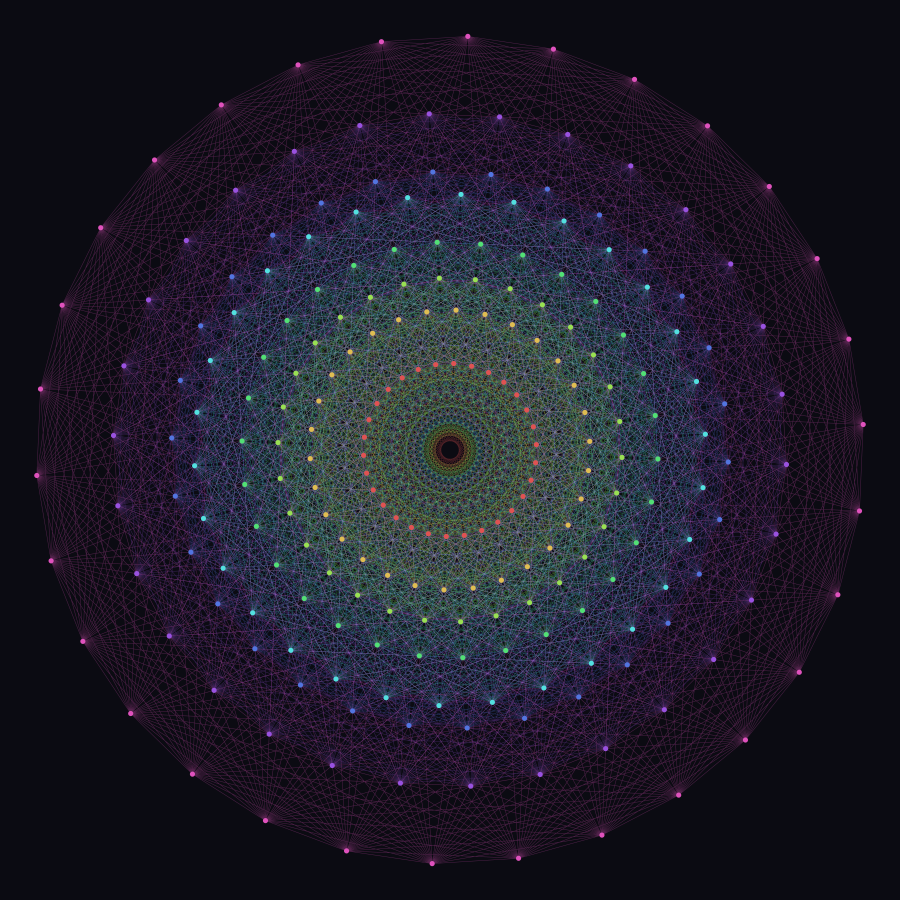
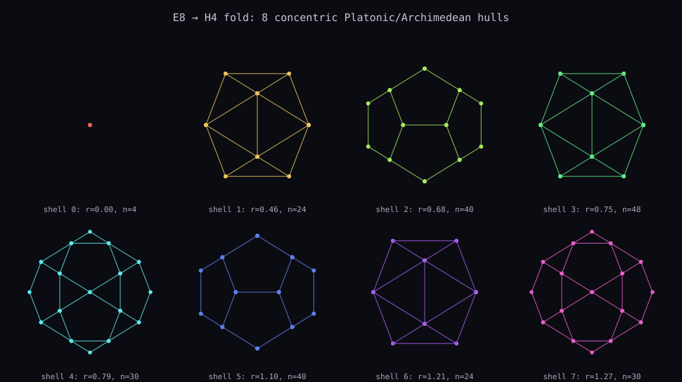
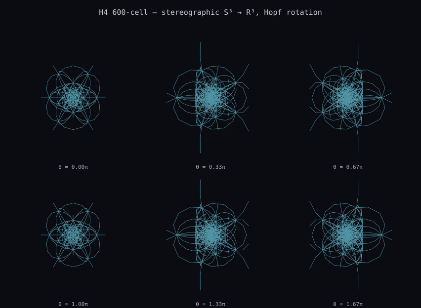

# @fxyz/e8

[](https://github.com/fxyznetwork/fxyz-e8/actions/workflows/ci.yml)

<p align="center">
  
  
  
</p>
<p align="center"><sub>
  E8 Coxeter-plane mandala — 8 shells of 30, 30-fold symmetry &nbsp;·&nbsp;
  8 concentric hulls from the H4 fold &nbsp;·&nbsp;
  H4 600-cell, stereographic Hopf rotation
  <br>
  Generated deterministically from this package's own exports — run <code>pnpm gallery</code>. The pictures can't drift from the math because they <em>are</em> the math's output. The first image is the genuine E8 mandala (<code>projectCoxeterPlane2D</code>); its 30-fold symmetry is <a href="#the-coxeter-plane-projection-the-e8-mandala">derived and test-locked</a>.
</sub></p>

A pure-math TypeScript toolkit for the E8 root system and its H4 (600-cell)
sub-structure — the 600-cell is the 4-D analogue of the icosahedron: 120
vertices, the densest of the six convex regular 4-polytopes — covering
root-system generation, multiple 2D/3D projections, hull extraction, and
folding between E8 and H4. Zero runtime dependencies, zero rendering
dependencies — the output is plain numbers (`number[]`, `Float32Array`,
`Float64Array`) that any renderer (three.js, WebGPU, a plot library, a CLI)
can consume.

## Why E8 matters

E8 is the largest of the exceptional simple Lie groups — a maximally
symmetric mathematical object with no smaller building blocks. Its 240 root
vectors generate the E8 lattice, which gives the densest known way to pack
spheres in 8 dimensions; proving that optimality was a landmark 2016 result
by Maryna Viazovska, work recognized with a Fields Medal in 2022. E8 also
recurs throughout theoretical physics, from grand unified theories to string
theory. This package implements the linear algebra behind E8's root system
and its projections — no physics, no claims beyond the math itself.

## Glossary

- **Root system** — a highly symmetric, finite set of vectors ("roots")
  that encodes a Lie algebra's structure. E8's root system has 240 roots,
  all the same length.
- **Coxeter number (h)** — an integer invariant of a root system (h = 30
  for E8) equal to the order of its Coxeter element, a distinguished
  symmetry that governs the system's rotational structure.
- **Coxeter plane / eigenplane** — the 2D plane spanned by an eigenvector
  pair of a root system's Coxeter element. A genuine projection onto it is
  exactly rotationally symmetric, with order equal to the Coxeter number
  (30 for E8). This package derives it and projects onto it in
  `projectCoxeterPlane2D`; see
  [The Coxeter-plane projection](#the-coxeter-plane-projection-the-e8-mandala).
- **Stereographic projection** — a mapping from a sphere (here S³, the
  3-sphere in 4D) onto flat space that preserves angles and turns
  great-circle arcs into circular arcs rather than straight lines.
- **Unimodular** — a matrix with determinant ±1, i.e. one whose linear
  transformation preserves volume.

## What it does

- **E8 root-system generation** — the 240 root vectors of the E8 exceptional
  Lie group in 8 dimensions (`e8-geometry.ts`), plus their edge adjacency
  (6,720 edges, each vertex has 56 neighbors).
- **Multiple projections** — the 2D `projectCoxeterPlane2D` mandala (the
  derived, test-locked Coxeter-plane projection with exact 30-fold symmetry;
  see [The Coxeter-plane projection](#the-coxeter-plane-projection-the-e8-mandala)),
  a legacy `projectPetrie2D` fixed-basis 2D projection kept for back-compat, a
  legacy Platonic-solid 3D basis, and a first-principles 3D projection via the
  H4 unimodular fold + axis drop (`e8-coxeter-plane.ts`, `e8-projections.ts`,
  `e8-3d-fold-projection.ts`).
- **E8 → H4 folding** — the explicit 8×8 folding matrix from Moxness (2014)
  that rotates E8 vertices into copies of the H4 600-cell, plus its
  unimodular (determinant = 1) form (`e8-h4-fold.ts`).
- **H4 600-cell stereographic projection** — projects the 600-cell from S³
  to ℝ³ with a 1-parameter SO(4) rotation, producing curved (great-circle)
  edges rather than straight chords (`h4-stereographic.ts`).
- **Hull / shell extraction** — classifies the 240 projected roots into
  concentric Platonic/Archimedean hulls, both via k-means (5 or 8 shells)
  and via the exact 8-shell radial multiset `{4, 24, 24, 30, 30, 40, 40, 48}`
  recovered by the fold projection (`e8-geometry.ts`, `e8-platonic-hulls.ts`,
  `e8-edge-norms.ts`).
- **Fold-morph interpolation** — precomputed endpoint buffers for animating
  between the 2D `projectPetrie2D` embedding and the 3D H4 fold, plus a CPU
  lerp implementation for parity testing or non-shader consumers
  (`e8-fold-morph.ts`).

## Install

```sh
npm install @fxyz/e8
# or
pnpm add @fxyz/e8
```

## Usage

```ts
import {
	generateE8RootSystem,
	generateE8Vertices8Hull,
	projectTo3DViaFold,
	getE8PlatonicHulls,
} from "@fxyz/e8";

// The 240 root vectors of E8, in 8 dimensions.
const roots = generateE8RootSystem(); // number[240][8]

// Project to 3D via the H4 unimodular fold + ST-axis drop.
const positions3D = projectTo3DViaFold(roots); // [number, number, number][240]

// Fully-typed vertices with paper-accurate 8-hull classification.
const vertices = generateE8Vertices8Hull();
// vertices[i] = { index, coords8D, position3D, norm3D, hull }

// Or go straight to the 8 concentric hulls as GPU-ready buffers.
const hulls = getE8PlatonicHulls();
// hulls[i] = { index, radius, vertexCount, vertices: Float32Array, edges: Float32Array, ... }
```

```ts
import {
	stereographicS3ToR3,
	so4RotationHopf,
	buildStereographic600CellEdges,
} from "@fxyz/e8";

// Stereographically project a point on S³ (the H4 600-cell's ambient
// sphere) to R³, after a 1-parameter SO(4) rotation.
const rotation = so4RotationHopf(Math.PI / 4);
const p = stereographicS3ToR3([0.5, 0.5, 0.5, 0.5]);
```

See each module's doc comment for the full API and the math it implements.

## Sources

This library is a transcription and composition of published mathematics,
not novel research. Primary sources:

- H. S. M. Coxeter, *Regular Polytopes*, 3rd ed. (Dover, 1973) — the 600-cell
  construction (§22.4) and Petrie polygon (§13.4).
- J. G. Conway & N. J. A. Sloane, *Sphere Packings, Lattices and Groups*
  (Springer, 3rd ed.) — the E8 lattice theta function (Ch. 4, Table 4.9),
  also catalogued as OEIS [A004009](https://oeis.org/A004009), "Theta
  series of E8 lattice" (`THETA_COEFFICIENTS` in `e8-constants.ts`).
- J. G. Moxness, *The 3D Visualization of E8 Using an H4 Folding Matrix*
  (2014) — the H4 folding matrix (`H4_FOLD_MATRIX`).
- J. G. Moxness, *Unimodular rotation of E8 to H4 600-cells* (2019,
  vixra:1910.0345) — the unimodular form (`H4_UNI_MATRIX`, determinant 1)
  and the CNOT/SWAP quantum-computing derivation.
- J. G. Moxness, *3D Polytope Hulls of E8* (2020) — the 8-shell radial
  multiset and the platonic/Archimedean hull structure.
- J. G. Moxness, "E8 and H4 in QM and QC" (undated preprint) — the H4 /
  H4φ sub-lattice ring partition and the paper-faithful edge-norm color
  classes.
- M. Koca, M. Al-Ajmi, N. K. Koca, "Polyhedra obtained from Coxeter groups
  and quaternions", arXiv:1204.4567 (2012).
- H. Hopf, "Über die Abbildungen der dreidimensionalen Sphäre auf die
  Kugelfläche" (1931) — the Hopf fibration underlying the 1-parameter SO(4)
  rotations used in the stereographic projection.

Where a projection basis or matrix is transcribed from a paper (rather than
derived first-principles in this code), the module doc comment says so and
notes any known numerical caveats (e.g. `MOXNESS_BASIS` is a legacy,
non-orthonormal transcription kept for parity testing — prefer
`projectTo3DViaFold`, which is derived from first principles and recovers
the published 8-shell multiset exactly).

## A note on rigor

The projection-specific math in this package — the H4 folding matrix, the
platonic-hull structure, and the edge-norm color classes — follows J. G.
Moxness's preprints, which are self-published (vixra, undated) and have not
been through peer review. We say so plainly rather than dress them up as
established literature.

What that status does *not* affect: the concrete, checkable claims are
independently verified by direct computation rather than by citation. This
package's own test suite (`pnpm test`, 109 assertions) checks the H4 folding
matrix's symmetry and determinant, the unimodular matrix's determinant = 1,
the exact 8-shell radial multiset `{4, 24, 24, 30, 30, 40, 40, 48}`, and the
E8 root/edge counts (240 roots, 6,720 edges, 56 neighbors per vertex). The
H4 600-cell's own combinatorics — 120 vertices on S³ in two copies scaled by
φ, each a 12-regular graph with 720 edges — is checked the same way, by
direct computation at generation time rather than by assumption (see
`deriveH4_600Cell` in `scripts/generate-gallery.ts`, which throws instead of
rendering if the derived structure doesn't match). A reproducible
computation is a stronger guarantee than an unreviewed citation — you don't
have to trust the source, you can run the numbers yourself.

## The Coxeter-plane projection (the E8 mandala)

`projectCoxeterPlane2D` (`e8-coxeter-plane.ts`) is the genuine E8 mandala: the
240 roots projected onto the Coxeter plane, producing eight concentric 30-gons
with exact 30-fold rotational symmetry. The basis is **derived**, not
transcribed:

1. Build the Coxeter element `w = s₁·s₂·…·s₈` (product of the eight simple
   reflections `E8_SIMPLE_ROOTS`) as an 8×8 matrix — `e8CoxeterElement()`. It is
   orthogonal with exact order 30 (`w³⁰ = I`; no smaller power is the identity).
2. Isolate its exp(±2πi/30) eigenplane as the null space of
   `M = w² − 2·cos(2π/30)·w + I`, via a Jacobi eigendecomposition of `MᵀM`.
3. Gram-Schmidt that 2-plane to the orthonormal pair `COXETER_PLANE_BASIS`.

Because the basis is orthonormal and the plane is `w`-invariant, `w` acts on it
as an exact rotation by 2π/30, so the projected point set is invariant under
that rotation. This is verified — not asserted — in
`src/__tests__/e8-coxeter-plane.test.ts`: the 240 roots land on exactly eight
radii of 30 points each; rotating the set by 2π/30 (and by every divisor of 30)
maps it onto itself at 100% within tolerance, while rotation by 2π/7 or 2π/8
does not, confirming the symmetry is exactly 30-fold. The measured out-of-plane
residual of `w·u1` is ≈3.5e-16 (machine precision). Run `pnpm test` to reproduce
the numbers yourself.

### A note on the legacy `projectPetrie2D`

`projectPetrie2D` (backed by the fixed `PETRIE_BASIS` in `e8-constants.ts`) is
kept for back-compat. Despite its name it is **not** the Coxeter plane: an
earlier doc comment claimed its basis were the exp(2πi/30) Coxeter eigenvectors,
but rotating its projected 240-point set by 2π/n for n = 2..60 matches only at
n = 2 — the trivial centrosymmetry (v ↦ −v) any linear projection of E8 inherits
for free — never at 30 or 8. `u1`/`u2` are a genuine orthonormal pair and the
projection is real and deterministic (48 distinct radii), but it does not
deliver the 30-fold symmetry. Use `projectCoxeterPlane2D` for the mandala; the
false claim has been removed from `PETRIE_BASIS`'s doc comment.

## Development

```sh
pnpm install
pnpm build      # tsup — emits dist/ (ESM + CJS + .d.ts)
pnpm test       # vitest
pnpm typecheck  # tsc --noEmit
pnpm gallery    # regenerate gallery/*.svg deterministically from the
                # library's own exports (scripts/generate-gallery.ts)
```

## Status

Pre-1.0. The public API may change between minor versions until 1.0.

## Provenance

Extracted from the [ƒxyz](https://fxyz.network) network monorepo, where this
module underlies the E8/H4 lattice geometry used in its 3D visualizations.
The network itself — its economics, member layer, and product code — stays
private; this package is the general-purpose math underneath it.

## Contributing

Issues and pull requests are welcome — see [CONTRIBUTING.md](./CONTRIBUTING.md)
and [CODE_OF_CONDUCT.md](./CODE_OF_CONDUCT.md). For security reports, see
[SECURITY.md](./SECURITY.md).

## License

[Apache License 2.0](./LICENSE) — see also [NOTICE](./NOTICE).
